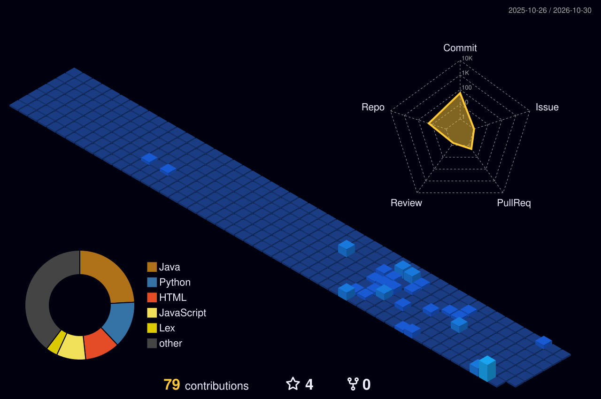

<!-- 🎬 HERO — name, roles, waving character -->

  

<!-- 👩‍💻 LEFT: what I build   •   🎨 RIGHT: life beyond code -->

  

<!-- ⚛️ TECH STACK -->

  

<!-- 🪪 DEVELOPER ID + DASHBOARD -->

## 💼 Experience

### Frontend Intern · [sapmenc](https://github.com/sapmenc)
Built the **Finance section UI** for **PortalOne's** admin dashboard (frontend).

- **Finance navigation** — pill tab bar (Overview, Bank Statements, Audited Statements, Payment Receipts, Payment Reminders, Bank Accounts) wired into the existing dashboard
- **Bank Statements page** — Recent Uploads card, Account / Year / Month filter dropdowns with a custom calendar icon and arrow-key scrolling, a document table with view / download actions, and pagination
- **Upload Statement modal** — built pixel-accurate to Figma (988 × 622): bank account picker, year / month / date wheel pickers (mouse wheel, click and drag), and a drag-and-drop upload zone with file cards and a hover-to-delete action
- **PDF preview** — "View" opens a modal that renders the statement in an embedded viewer
- **Code review** — shipped fixes from senior review feedback (heading alignment, upload component, multi-value drag)
- **Git workflow** — opened two PRs and resolved a merge conflict with a teammate's backend code without losing any of their changes
- **Debugging** — found and reported an UploadThing × Next.js 16 Turbopack build bug, with a working workaround (`pnpm exec next dev --webpack`)

`Next.js` `React` `Figma` `pnpm` `UploadThing` `Git`

## 🚀 Featured builds

| Project | What it is | Stack |
|:---|:---|:---|
| **HomeFeast** *(in progress)* | Full-stack platform connecting people with homemade tiffin & food providers — auth, ordering, order management | `React` `Node.js` `Express` `MongoDB` `Tailwind` |
| [**Secure API Monitoring System**](https://github.com/SoujanyaRRao/api-monitoring-system) | Monitors registered API endpoints with scheduled health checks, response times, uptime % and failure history on a dashboard — secured with JWT, per-user data isolation, rate limiting and SSRF protection | `Java 17` `Spring Boot` `Spring Security` `MySQL` `React` |
| [**FiberLens AI**](https://github.com/SoujanyaRRao/FiberLens-AI-Final) | Scans clothing care labels with AI vision to read fabric composition, estimate microplastic-shedding risk and give a sustainability score | `Python` `Gemini API` `Computer Vision` |
| [**GoFood — Food Delivery App**](https://github.com/SoujanyaRRao/Food-Delivery-System) | MERN food delivery app: JWT login, category browsing with search, cart and order history | `React` `Node.js` `Express` `MongoDB` |
| [**PortalOne — Finance module**](https://github.com/sapmenc/PortalOne) *(internship @ sapmenc)* | Finance section of an admin dashboard: tabbed navigation, Bank Statements page with filters, table and pagination, Figma-accurate upload modal with wheel pickers and drag-and-drop, and in-app PDF preview | `Next.js` `React` `Figma` `Git` |
| [**Self-Healing RAG**](https://github.com/Shreya046/Self-Healing-RAG) *(collab)* | Collaborative retrieval-augmented generation (RAG) project | `Python` `LLMs` `RAG` |
| [**Credit Card Fraud Detection**](https://github.com/SoujanyaRRao/Credit-Crad-Fraud-Detection) | End-to-end ML pipeline — cleaning, feature engineering, model training — served through a Streamlit app | `Python` `Pandas` `Streamlit` |
| [**Compiler Design**](https://github.com/SoujanyaRRao/Compiler_design) | Unix, Lex and YACC programs | `Lex` `YACC` `C` |

## 🌃 My contributions, as a city

  

<!-- 💌 CONNECT -->

⭐ Thanks for visiting — keep coding, keep growing.

